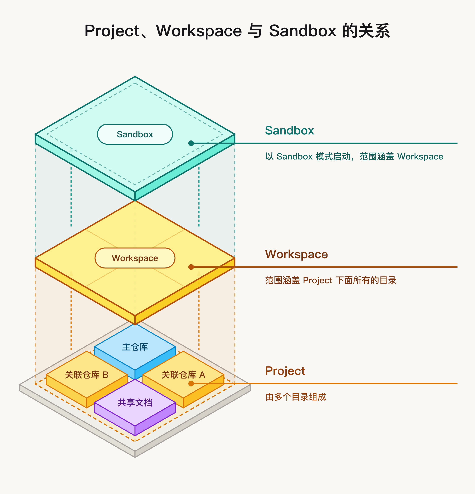

Gemini 4 的模型能力很强，但 Google 的 Antigravity 本身确实很难用。因为大家远程干活时更习惯直接连接 CLI，这里就聚焦在 Antigravity CLI（简称 agy）上，分享几项能明显降低摩擦的设置，让它不那么难用。

日常在终端里用下来，最影响体验的硬伤有四个：

* **权限授权弹框没完没了**：跨目录读文件、写临时文件、调 MCP 工具，甚至读取通过 `npx skills` 装进去的全局技能，都会频繁弹出授权确认。
* **上下文窗口（context window）大小是写死的**：Antigravity 没有任何配置项可以按任务需要调整上下文上限。
* **上下文压缩（compaction）做得很烂**：长对话一旦触发自动压缩，关键上下文经常被压丢，后续回答质量明显下滑。
* **输入框快捷键和主流 Agent 拧着来**：在 agy 中，单按 Esc 或 Ctrl+C 清不掉聊天框里已输入的文字，连按两次 Esc 也不能像 Claude Code 那样触发 rewind，必须手动输入 `/rewind`。

上下文窗口写死和压缩质量差属于 harness 本身的短板，在 Google 改进之前我们改不了。但围绕**压住高频权限弹框**、**界面定制、可观测性与隐私保护**、**快捷键习惯切换**这三件事，可以用下面 9 招让你的 Antigravity CLI 不那么难用。

## 先搞清楚命令行的配置存在哪

由于命令行与图形界面支持的特性不同（例如图形界面支持 Generative UI 等富交互特性，而 agy 是面向终端与远程 SSH 场景的独立轻量级客户端），**agy 的配置文件存储在独立的位置，配置方式也与图形界面完全独立**。

> **重要提示：** 你在 Antigravity 图形界面里改过的任何权限或偏好都不会在 agy 里生效。命令行所有的配置与目录都集中在 `~/.gemini/antigravity-cli/` 下。

| CLI 配置项 | Antigravity CLI（agy）存储路径 | 会话内交互命令 |
| :--- | :--- | :--- |
| **运行模式、沙箱与工具权限** | `~/.gemini/antigravity-cli/settings.json` | `/settings`（或 `/config`）与 `/permissions` |
| **自定义快捷键映射** | `~/.gemini/antigravity-cli/keybindings.json` | `/keybindings` |
| **全局 Skills 目录** | `~/.gemini/antigravity-cli/skills/` | — |

* **所有 CLI 运行设置与权限白名单都保存在 `~/.gemini/antigravity-cli/settings.json`**：你可以直接编辑这个 JSON 文件，也可以在 agy 会话内用 `/settings` 和 `/permissions` 实时修改。
* **agy 读取的全局 Skills 目录是 `~/.gemini/antigravity-cli/skills/`**：只要技能文件没装进这个目录，启动时要么识别不到，要么读取时会被当成越界访问而反复弹授权。

## 压住高频权限弹框

刚上手 Antigravity 时，最直观的感受是权限弹框多到没法干活；但把整套机制摸透之后会发现，**Antigravity 的权限模型本质上是围绕 Project、Workspace 与 Sandbox 这三个核心概念构建的**：

* **Project**：将磁盘上的一个或多个物理仓库目录归入同一个项目下（在 agy 中可通过 `/projects` 或 `--add-dir` 配置，默认只包含当前启动目录 `default-cli-project`）。
* **Workspace**：由当前生效 Project 所包含的全部目录共同组成。在 Agent Mode 设为 Auto 时，Antigravity 把 Workspace 作为唯一的文件默认信任范围，连 Workspace 之外的 `read_file` 读取操作默认都会拦截弹框。
* **Sandbox**：基于 Workspace 建立操作系统级隔离边界（在 agy 中对应 `"enableTerminalSandbox": true`，macOS 下为 Seatbelt `sandbox-exec`，Linux 下为 `bwrap`），并允许你通过 Tool Permission 选择「**沙箱内自动放行、沙箱外请求权限**（`"proceed-in-sandbox"`）」或「**全局自动放行**（`"always-proceed"`）」。

理解了 Project、Workspace 与 Sandbox 三者的关系（见下图），就能看清默认配置为什么处处受阻，以及如何针对不同信任边界配置自动放行：



在默认状态下（见下图），即使把 Agent Mode 设为 Auto，由于未开启 Sandbox、只使用单目录默认 Project、Tool Permission 保持为 Request review 且 `/permissions` 白名单为空，除了当前启动目录内的文件读写之外，跨仓库访问、跑终端命令、写 `/private/tmp` 临时文件、查阅系统 SDK 与调用 MCP 服务都会频繁触发弹框：

![竖向单列流程图「默认状态」。每个二级配置块右侧带有状态标签，下方直接写出该配置项的实际效果：顶部「Agent Mode: Auto（自动放行）」效果为当前 Workspace 内的文件读取与写入免弹框自动放行；中部「/settings 与 /projects」依次为「Sandbox Mode: Off（未启用沙箱：终端命令直接运行在宿主机，无法使用 Proceed in sandbox）」「Project: default-cli-project（触发弹框：Workspace 仅含当前单目录，读写关联仓库或共享文档均弹框）」「Non-Workspace Access: Off（触发弹框：未配置白名单时，访问 Workspace 外的任何路径均弹框）」「Tool Permission: Request review（触发弹框：执行任何终端命令如 git status、ls、npm test 前均弹框）」；下部「/permissions」中「permissions.allow: []（触发弹框）」效果为调用 MCP、读写 /private/tmp 临时文件与读取系统 SDK 均弹框；底部最终结果卡为「反复暂停等待人工授权」。](./figure-2-default-permission-flow.png "默认状态")

因此，在给出两套完整的自动放行配方之前，我们需要先做两项基础准备：**通过配置 Project 将关联仓库纳入 Workspace**，以及**在配置文件里补齐高频越界操作的权限白名单**。

### 通过配置 Project 将其他仓库目录加入 Workspace

因为 Antigravity 对 `read_file` 的默认规则是 **Ask (Allowed in workspace)**——只对 Workspace 内的文件免弹框，一旦读取 Workspace 之外的文件，就算打开了 Non-Workspace Access 也照样弹框——所以当任务涉及多个关联目录（比如前端仓库、后端仓库和共享文档）时，最省心的做法是通过配置 Project 将这些目录直接加入 Workspace 与 Sandbox 边界。

在 agy 里可以通过 `/projects`（或启动参数 `--project`）配置 Project 下的目录，也可以用 `--add-dir` 与 `/add-dir` 把关联目录挂载进当前 Workspace：

```bash
# 启动时直接指定进入某个多目录 Project（最省事）
agy --project=<project-id>

# 或者在启动时将多个关联目录一起纳入当前 Workspace 与 Sandbox 边界
agy --add-dir ../backend --add-dir ../shared-specs
```

```text
# 一进 agy 会话先执行 /projects 配置并切换 Project
/projects
/add-dir ../shared-specs
```

* **建 Project 和切 Project 必须是进 agy 之后干的第一件事**：因为在 agy 里切换 Project 永远会新起一个对话，如果你先聊了半天再去新建或切换 Project，前面聊出来的上下文都会留在老对话里带不过去。
* **新建 Project 后必须手动切换才会生效**：新建好一个 Project 并配完目录后，如果你没有显式选择 **Switch to project**（或下次启动时直接带上 `agy --project=<project-id>`），当前会话依然留在默认的 `default-cli-project` 下运行，跨目录读文件还是会照弹不误。
* **配进 Project 的目录自动归入 Workspace 免弹框范围**：凡是配置在当前生效 Project 下的目录，无论是内置 `read_file`、`write_file` 还是在 Sandbox 内跑终端脚本，都直接作为 Workspace 内部操作放行，不再弹出授权框。

### 在配置文件里补齐权限白名单

对于既不属于当前 Project 仓库目录、又会在日常任务中频繁触发 Ask 弹框的三类操作——常用 MCP 工具调用、macOS 下的 `/private/tmp` 临时文件读写，以及系统 SDK 目录（例如 Apple SDK 目录）与跨项目公共参考目录读取——可以通过 `/permissions` 或直接在 `~/.gemini/antigravity-cli/settings.json` 的 `"permissions"` 下配置 `allow` 白名单（按 Deny > Ask > Allow 优先级匹配）：

```json
{
  "permissions": {
    "allow": [
      "mcp(playwright/*)",
      "mcp(chrome-devtools/*)",
      "mcp(cua/*)",
      "mcp(github/*)",
      "mcp(context7/*)",
      "write_file(/private/tmp)",
      "read_file(/Library/Developer/CommandLineTools/SDKs/)",
      "read_file(/Applications/Xcode.app/Contents/Developer/Platforms/)",
      "read_file(/path/to/shared-dir/)"
    ]
  }
}
```

* **第一类：`mcp(<server-name>/*)` 一次性放行常用 MCP 服务下的全部工具权限**：Antigravity 权限表中 MCP 的默认回退策略始终是 Ask。把常用的 MCP 服务名加进白名单——例如浏览器自动化常用的 `mcp(playwright/*)`、调试常用的 `mcp(chrome-devtools/*)`、Computer-Use Agent 常用的 `mcp(cua/*)`，以及 `mcp(github/*)`、`mcp(context7/*)`——就能免去每次调用工具前的逐次确认。
* **第二类：`write_file(/private/tmp)` 解决 macOS 下 `/tmp` 软链接导致的读写弹框**：macOS 的 `/tmp` 实际是指向 `/private/tmp` 的符号链接，工具在读写临时文件前一旦解析出真实路径 `/private/tmp/...`，就会命中 Workspace 外的 Ask 默认策略并弹窗求授权；根据官方文档，放行 `write_file(/private/tmp)` 会**自动隐式包含 `read_file(/private/tmp)` 权限**，一条规则即可同时消掉 `/private/tmp` 下的读和写弹框。
* **第三类：`read_file(...)` 放行系统 SDK 目录（如 Apple SDK 目录）与跨项目公共参考目录的读取权限**：因为 Workspace 外的路径默认是 Ask，当 Agent 查阅系统头文件、Framework 接口定义（如 macOS 下的 `/Library/Developer/CommandLineTools/SDKs/` 与 `/Applications/Xcode.app/Contents/Developer/Platforms/`）或跨项目共享资料库时就会频繁弹框。把这些常用系统 SDK 目录与公共参考目录加进 `read_file(...)` 权限白名单，即便保持 `"allowNonWorkspaceAccess": false` 也能直接覆盖放行、彻底消掉跨目录读取弹框，同时还会自动将这些路径挂载进终端 Sandbox 的只读白名单。

### 在 Settings 里选择自动放行配方

完成了 Project 目录扩展与 `permissions.allow` 白名单配置后，在 agy 里打开 `/settings`（或直接编辑 `~/.gemini/antigravity-cli/settings.json`），就可以根据你想要「守住边界」还是「全局自动放行」，从下面两套完整权限配方中二选一：

#### 配方一：沙箱与白名单内自动放行

这套配方让你在当前 Workspace（含已加入 Project 的关联仓库）、内核 Sandbox 与 `permissions.allow` 白名单内拥有免打断的流畅体验；一旦 Agent 试图读或写任何未加入 Project 且不在白名单里的外部路径，都会弹出确认框交由你把关（见下图）。

启动时挂载关联仓库（或在会话内通过 `/projects` 切换到配好多目录的 Project）：

```bash
agy --project=<project-id>
# 或临时挂载关联目录：
agy --add-dir ../backend --add-dir ../shared-specs
```

并在 `~/.gemini/antigravity-cli/settings.json` 中写入完整权限与白名单配置：

```json
{
  "agentMode": "auto",
  "enableTerminalSandbox": true,
  "allowNonWorkspaceAccess": false,
  "toolPermission": "proceed-in-sandbox",
  "permissions": {
    "allow": [
      "mcp(playwright/*)",
      "mcp(chrome-devtools/*)",
      "mcp(cua/*)",
      "mcp(github/*)",
      "mcp(context7/*)",
      "write_file(/private/tmp)",
      "read_file(/Library/Developer/CommandLineTools/SDKs/)",
      "read_file(/Applications/Xcode.app/Contents/Developer/Platforms/)",
      "read_file(/path/to/shared-dir/)"
    ]
  }
}
```

![竖向单列流程图「配方一：沙箱与白名单内自动放行」。顶部「Agent Mode: Auto（自动放行）」放行当前 Workspace 内读写；中部「/settings 与 /projects」依次为「Sandbox Mode: On（启用沙箱：启用系统级沙箱隔离终端命令，并解锁 Proceed in sandbox）」「Project: /projects · --add-dir（自动放行：将关联仓库与共享文档纳入 Workspace，跨仓库读写不再弹框）」「Non-Workspace Access: Off（越界把关：防止 Auto 模式静默改写外部文件，仅放行下方白名单路径）」「Tool Permission: Proceed in sandbox（自动放行：沙箱内执行的终端命令全部自动放行）」；下部「/permissions」包含「permissions.allow（自动放行：优先级高于 Non-Workspace Access: Off，放行 mcp(playwright/*)、write_file(/private/tmp) 与 read_file(SDKs/*)）」与「未列入 permissions.allow 的路径与 MCP（触发弹框：凡未命中上方白名单的 Workspace 外读写与陌生 MCP 均弹框把关）」；底部最终结果卡为「沙箱与白名单内畅行，越界严格把关」。](./figure-3-recipe-1-sandbox-flow.png "配方一：沙箱与白名单内自动放行")

#### 配方二：全局自动放行

如果你在独立开发机、云端远程容器里干活，或者单纯希望 Agent 无论在 Workspace 内还是跨出 Workspace 读写文件、跑命令都一路往前冲，可以把 `"toolPermission"` 设为 `"always-proceed"` 并将 `"allowNonWorkspaceAccess"` 设为 `true`。此时跨目录文件读写与 `/private/tmp`、系统 SDK 访问都会直接放行，无需再手动配置多目录 Project 或文件路径白名单，只需保留常用 MCP 白名单即可（若启动时直接带 `agy --dangerously-skip-permissions`，甚至连 MCP 白名单都不需要配，见下图）：

```json
{
  "agentMode": "auto",
  "enableTerminalSandbox": true,
  "allowNonWorkspaceAccess": true,
  "toolPermission": "always-proceed",
  "permissions": {
    "allow": [
      "mcp(playwright/*)",
      "mcp(chrome-devtools/*)",
      "mcp(cua/*)",
      "mcp(github/*)",
      "mcp(context7/*)"
    ]
  }
}
```


两套配方中核心设置项的分工如下：

* **Agent Mode（`"agentMode"`）设为 `"auto"`**：Agent Mode 共有 Default、Plan、Auto、Accept Edits 四种，日常主力直接用 `"auto"`（会话内也可按 Shift + Tab 切换），自动放行当前 Workspace 内的文件读写（注意 Antigravity 的权限粒度只有 `read_file` 和 `write_file`，没有单独的 `edit_file` 权限项，所有文件修改统一归口在 `write_file` 下）。
* **Sandbox Mode（`"enableTerminalSandbox"`）设为 `true`**：agy 默认不在 Sandbox 里运行；打开 Sandbox Mode 后，终端命令会跑在系统原生内核沙箱里（macOS 下为 Apple Seatbelt `sandbox-exec`，Linux 下为 `bwrap` 命名空间），自动阻断未授权外网连接与 `~/.ssh` 等宿主机敏感目录，同时为开启 Proceed in sandbox 提供前提。
* **Non-Workspace Access（`"allowNonWorkspaceAccess"`）在配方一下务必保持为 `false`（避开「读拦写不拦」陷阱）**：当 `"allowNonWorkspaceAccess"` 为 `false` 时，越界访问会弹出三选项菜单（第 2 项为允许 Non-Workspace Access），很多用户为了省事会顺手选第 2 项把它改成 `true`。因为 Auto 模式的定义是自动放行文件编辑操作，而 `read_file` 的默认回退策略则是 Ask (Allowed in workspace)；一旦在 Auto 模式加 `"proceed-in-sandbox"` 下把 `"allowNonWorkspaceAccess"` 设为 `true`，就会出现反直觉的**「读拦写不拦」**现象——**Agent 读 Workspace 外未加白名单的文件依然会弹框，但在 Workspace 外任意未加白名单的目录创建或覆写文件（`write_file`）却完全不弹框、直接静默落盘**！反过来，**`permissions.allow` 的优先级高于 `"allowNonWorkspaceAccess": false`**：在配方一下只要保持 `"allowNonWorkspaceAccess": false`，再把常用的外部目录写进 `permissions.allow`，白名单内的读写照样零弹框通过，而白名单外的未知读和未知写都能被严密拦截。
* **Tool Permission（`"toolPermission"`）决定采用哪套配方**：默认是 Request review（跑 `git status`、`npm test`、`ls -la` 都要弹框确认）；改成 `"proceed-in-sandbox"`（**配方一**）后，Sandbox 与 Workspace 内的命令和读写全部免弹框自动执行，越界操作则请求权限；改成 `"always-proceed"`（**配方二**）后，Workspace 内外的读写与命令全部免弹框一路绿灯。

### 修正 npx skills 安装目录错误带来的授权弹框

执行 `npx skills add <owner/repo> -g` 时，`npx skills` 默认会把全局技能装进 `~/.agents/skills/`，而不是 agy 读取的 `~/.gemini/antigravity-cli/skills/`。因为 `~/.agents/skills/` 位于当前 Workspace 之外，每次读取 `SKILL.md` 或附带脚本都会被当成越界访问而弹出授权框。

用 `ln -sf` 把 `~/.agents/skills` 链到 `~/.gemini/antigravity-cli/skills` 即可：

```bash
ln -sf ~/.agents/skills ~/.gemini/antigravity-cli/skills
```

## 界面定制、可观测性与隐私保护

默认状态下，agy 不仅默认开启遥测数据收集，还会在终端顶部栏把个人账号挂出来、在底部轮播提示，同时历史会话列表和执行日志的可观测性也不够顺手，可以用下面四项设置一并调好。

### 关闭遥测数据收集

Antigravity 默认开启了 **Enable Telemetry**，用于收集使用数据。如果你注重 Workspace 与终端会话的隐私，建议第一时间把它关掉。

这里有一个容易踩坑的细节：当你使用 Google 账号登录时，**Enable Telemetry** 是绑定在云端账号上的设置项，单靠修改本地 `settings.json` 并不会同步关闭云端开关；而在使用 API Key 模式时，遥测则由本地 `~/.gemini/antigravity-cli/settings.json` 里的 `"enableTelemetry": false`（或启动参数 `--disable_telemetry`）控制。因此最稳妥的做法是两边同时关掉：

1. 在 agy 会话内输入 `/settings`（或 `/config`），直接输入 telemetry 搜索，将 **Enable Telemetry** 切换为 **off**。
2. 在 `~/.gemini/antigravity-cli/settings.json` 中加上：

```json
{
  "enableTelemetry": false
}
```

### 隐藏顶部账号信息与启动 Logo

默认启动 agy 时，终端顶部左侧会打印一块彩色像素风 ASCII Logo，右侧则会直接把你登录的 Google 邮箱挂出来（见下图上方窗口）。对于平时开直播写代码、录演示视频或者截屏发帖的人来说，顶部一旦入镜就会直接暴露个人账号隐私。

在 `~/.zshrc`（或 `~/.bashrc`）里加上这两个环境变量，就能默认隐藏它们（见下图下方窗口）：

```bash
export AGY_CLI_HIDE_ACCOUNT_INFO=1
export AGY_CLI_HIDE_LOGO=1
```


如果你平时自己用不介意显示，只想在开直播、录屏或截图时临时隐去，也可以封装成一条 shell `alias`：

```bash
alias agy-live='AGY_CLI_HIDE_ACCOUNT_INFO=1 AGY_CLI_HIDE_LOGO=1 agy'
```

* **`AGY_CLI_HIDE_ACCOUNT_INFO=1` 专为直播与录屏隐藏顶部栏账号信息**：从终端顶部抹掉登录邮箱，开播或录屏切终端窗口时不再担心漏号。
* **`AGY_CLI_HIDE_LOGO=1` 关掉启动时的 ASCII Logo**：在分屏终端或 `tmux` 窄窗口下省掉顶部留白，界面更紧凑。

### 关掉底部轮播的使用提示

在模型生成回复的过程中，agy 默认会在加载动画下方不断轮播快捷键与使用小贴士（tooltip / tips）。熟悉基本操作之后，这块跳动的文字纯粹是视觉干扰。

在 `~/.gemini/antigravity-cli/settings.json` 里把它关掉即可（也可以在 `/settings` 面板里把 **Show Tips** 设为关闭）：

```json
{
  "showTips": false
}
```

### 开启高可观测性并按 Workspace 分组历史会话

如果你希望更清楚地看到 Agent 思考过程与每次工具调用的完整细节，同时在 `/resume` 恢复历史对话时按 Workspace 归类，可以在 `/settings`（或 `~/.gemini/antigravity-cli/settings.json`）里改好这两项：

```json
{
  "verbosity": "high",
  "pickerGrouping": "grouped"
}
```

* **`"verbosity": "high"`（Verbosity）提供完整的可观测性**：默认值 `"medium"` 会把连续的工具调用和思考过程折叠成摘要；改成 `"high"` 后，每一次工具调用、后台命令输出与思考过程都会完整展开，排查 Agent 行为时清晰得多。
* **`"pickerGrouping": "grouped"`（Conversation Picker Grouping）让 `/resume` 按 Workspace 分组**：默认值 `"none"` 会把所有目录的历史对话混在一个平铺列表里；改成 `"grouped"` 后，执行 `/resume` 时会自动按 Workspace 对历史对话做分组聚合（在列表里按 Ctrl+F 也可临时切换）。

## 适应与主流 Agent 不同的快捷键

### 用连按两次 Esc 清空输入，用斜杠命令触发 Rewind

从 Claude Code 或 Codex 切到 agy 时，命令行聊天框的按键手感非常别扭。查过官方 CLI 手册后会发现，它本来就是这样设计的——agy 把 Esc 和 Ctrl+C 绑定在受保护的 `cli.escape` 动作上，且按键分工和其他 Agent 完全错位：

| 你想做的操作 | Claude Code / Codex 习惯 | Antigravity CLI（agy）实际做法 |
| :--- | :--- | :--- |
| **清空输入框里已打出的文字** | 按一下 Ctrl+C 或单按 Esc | 空闲状态下**连按两次 Esc（Esc Esc）** |
| **回滚（Rewind）到之前的对话节点** | 空输入框下连按两次 Esc（Esc Esc） | 必须手动输入 **`/rewind`**（或简写别名 **`/undo`**） |
| **打断正在输出的模型回复** | 按 Esc 或 Ctrl+C | 单按一次 **Esc** 或单按一次 **Ctrl+C** |
| **退出命令行会话** | Ctrl+D 或连按两次 Ctrl+C | 空输入框下按 **Ctrl+D**，或空闲时**连按两次 Ctrl+C** |

* **单按 Esc 或 Ctrl+C 清不掉输入框里的字**：在模型未输出时，单按一下 Esc 不会清空已输入的文本；按 Ctrl+C 也清不掉文字，连按两次 Ctrl+C 反而会直接退出整个 agy 会话。
* **连按两次 Esc 被占用来「清空输入框」了**：因为官方把 Esc Esc 分配给了清空当前输入框，所以连按两次 Esc 无法触发对话回滚。
* **回滚历史必须手动输 `/rewind`（或 `/undo`）**：要回退到前面的某条消息，只能显式输入 `/rewind`，嫌长可以用官方内置的同义短命令 `/undo`。

## 一键抄作业完整配置

根据你的使用偏好，将以下两套配方之一合并进 `~/.gemini/antigravity-cli/settings.json`（首次配置时别忘了在 agy 里打开 `/settings` 搜索 telemetry，把账号级的 **Enable Telemetry** 也设为 off）：

### 配方一：沙箱与白名单内自动放行

```json
{
  "agentMode": "auto",
  "enableTerminalSandbox": true,
  "allowNonWorkspaceAccess": false,
  "toolPermission": "proceed-in-sandbox",
  "enableTelemetry": false,
  "verbosity": "high",
  "pickerGrouping": "grouped",
  "showTips": false,
  "permissions": {
    "allow": [
      "mcp(playwright/*)",
      "mcp(chrome-devtools/*)",
      "mcp(cua/*)",
      "mcp(github/*)",
      "mcp(context7/*)",
      "write_file(/private/tmp)",
      "read_file(/Library/Developer/CommandLineTools/SDKs/)",
      "read_file(/Applications/Xcode.app/Contents/Developer/Platforms/)",
      "read_file(/path/to/shared-dir/)"
    ]
  }
}
```

### 配方二：全局自动放行

```json
{
  "agentMode": "auto",
  "enableTerminalSandbox": true,
  "allowNonWorkspaceAccess": true,
  "toolPermission": "always-proceed",
  "enableTelemetry": false,
  "verbosity": "high",
  "pickerGrouping": "grouped",
  "showTips": false,
  "permissions": {
    "allow": [
      "mcp(playwright/*)",
      "mcp(chrome-devtools/*)",
      "mcp(cua/*)",
      "mcp(github/*)",
      "mcp(context7/*)"
    ]
  }
}
```

在 `~/.zshrc` 中加入隐私与界面精简环境变量：

```bash
export AGY_CLI_HIDE_ACCOUNT_INFO=1
export AGY_CLI_HIDE_LOGO=1
```

最后在终端执行一次全局 Skills 目录链接：

```bash
ln -sf ~/.agents/skills ~/.gemini/antigravity-cli/skills
```
