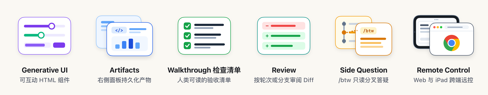
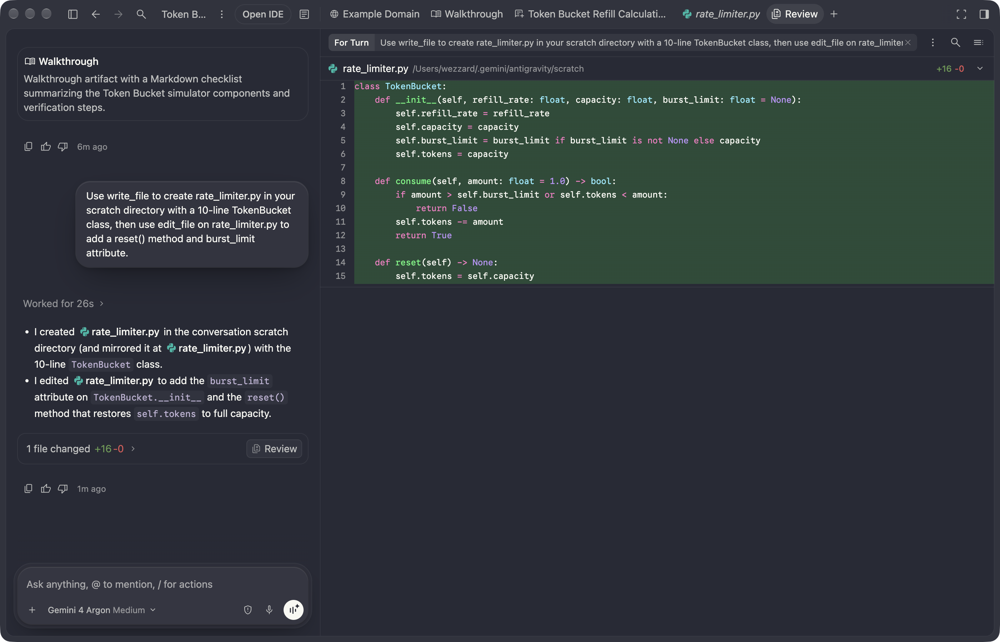
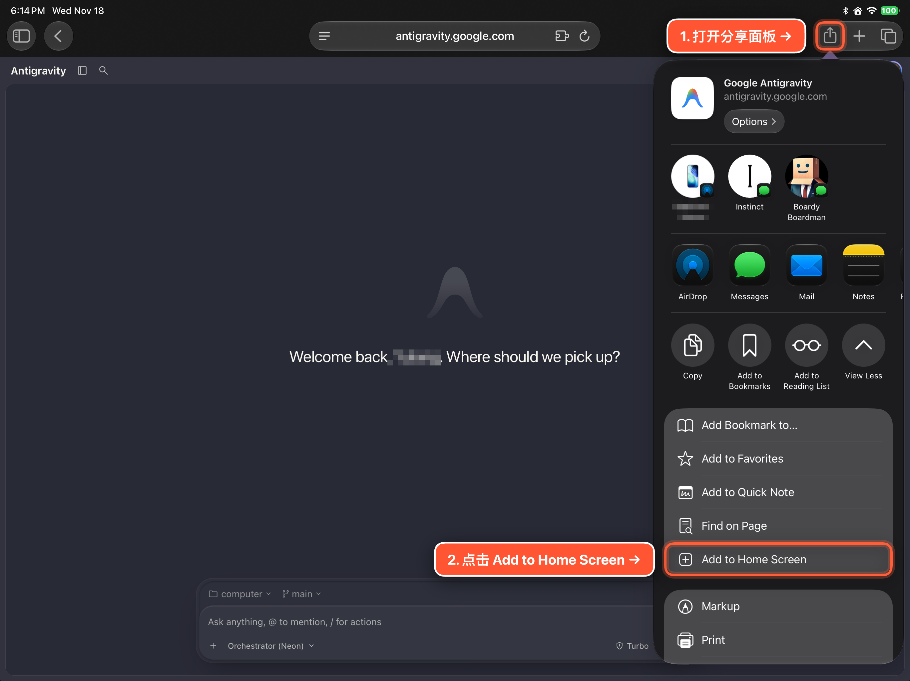
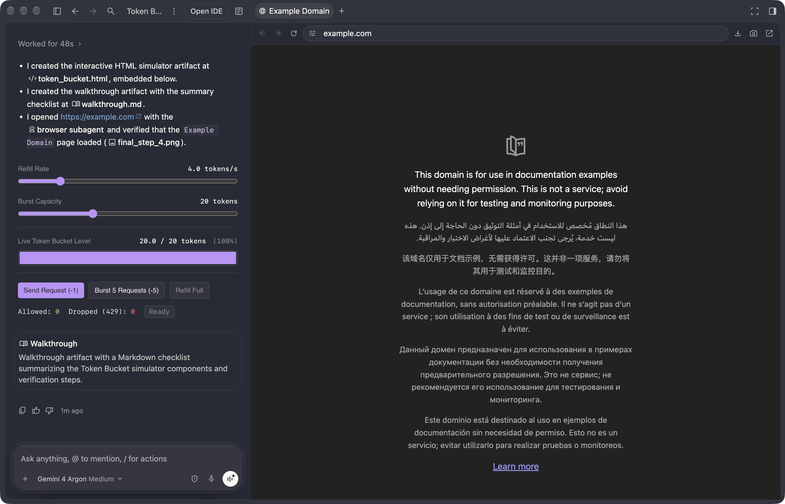

写前一篇 [9 招让你的 Antigravity CLI 不那么难用](https://wezzard.com/zh-Hans/post/2026/11/making-antigravity-cli-usable-7276/) 时，我之所以从命令行端 `agy` 切入，很大程度上是因为当时市面上不少第三方远程控制客户端都是基于 CLI 命令行构建的。但实际上，2.0 的 **Antigravity app** 本身就已经内置了原生远程控制，而且配合右侧多功能面板，它可以提供更立体和丰富的项目创作体验。

如下图所示，**Antigravity app** 围绕复杂项目提供了五个核心工具——**Generative UI**、**Artifacts**、**Walkthrough 检查清单**、**Review** 与 **Side Question**（`/btw`）——外加原生 **Remote Control**（在 iPad 上将 [antigravity.google.com](https://antigravity.google.com) 添加到主屏幕后，它就直接变成了一个在 iPad 上全屏运行的 App）：



本文先带你直观感受 **Antigravity app** 的这套可视化侧面板工作流与 iPad 远控体验，再帮你顺手解决掉实际使用中一定会碰到的两个开箱配置 Glitch：

1. **权限是如何设置的：** 为什么开了 Auto 模式还是老弹框，以及如何在设置界面把本地权限（**This Computer**）与远控权限（**Remote**）双双设为 **Turbo**。
2. **Skills 与 Plugins 到底怎么放、怎么装：** 如何打通 **Antigravity app**、**Antigravity IDE** 与 **Antigravity CLI**（`agy`）三端的全局 Skills 与 Plugins 目录。

## Antigravity app 的独特优势：Generative UI 及侧面板

相比纯 CLI 客户端或第三方命令行套壳工具，**Antigravity app** 在做项目时的核心优势集中在它的 Generative UI 与右侧面板。它内置了 **Generative UI** 等实用技能（后续我们还可以通过自定义 Skill 进一步优化它的内置提示词），配合右侧面板的 **Artifacts**、**Walkthrough**、**Review** 与 **Side Question**（`/btw`），把复杂项目的状态可视化、阶段核验、代码审阅和旁路查代码整合到了同一个窗口里。

### Generative UI、Artifacts 与 Walkthrough 检查清单

**在 Antigravity app 中做复杂项目时，一方面可以让 Agent 调用内置的 `generative_ui` 技能把抽象逻辑渲染成可互动的 HTML Artifact，另一方面可以明确要求 AI 生成一份 Walkthrough，用人类可读的 Markdown 检查清单把控项目进度。**

如下图所示，在一个构建 Token Bucket 限流模拟器的会话中，左侧对话流直接内联渲染了可拖拽调节 Refill Rate 与 Burst Capacity 的互动式 HTML 组件，右侧面板则打开了对应的 **Walkthrough** 检查清单，最右侧的 **Artifacts** 栏则常驻列出了当前会话沉淀的产物卡片：

![Antigravity app 真实运行截图「Artifacts（Generative UI）与 Walkthrough 检查清单」。左侧对话列中，Agent 通过 generative_ui 技能内联渲染了一个互动式 Token Bucket 模拟器组件（包含 Refill Rate 4.0 tokens/s 与 Burst Capacity 20 tokens 滑块、实时紫色令牌桶水位条，以及 Send Request (-1)、Burst 5 Requests (-5)、Refill Full 按钮），下方附带 Walkthrough 卡片；右侧面板打开了「Walkthrough」标签页（标题为 Token Bucket Simulator Walkthrough），以人类可读的 Markdown 检查清单逐项列出 Interactive HTML Artifact、Refill Rate Slider、Burst Capacity Slider、Live Bucket Bar、Traffic Simulation Controls 与 Browser Verification 的实现与验证状态，最右侧 Artifacts 栏列出 Walkthrough 与 Token Bucket 两个产物。](./figure-3-generative-ui-and-walkthrough.png "Antigravity app 中的 Generative UI 组件、Artifacts 栏与右侧面板 Walkthrough 检查清单")

* **Generative UI 与 Artifacts 让项目状态一目了然：** 借助内置的 `generative_ui` 技能，Agent 可以生成自包含的互动式 HTML 面板（既能像上图左侧那样内联嵌入对话流，也能通过最右侧的 **Artifacts** 栏在侧面板中作为独立标签页随时打开），直接帮助我们直观理解与调试正在做的项目。
* **Walkthrough 本质上是一份人类可读的 Markdown 检查清单：** 每当完成一个阶段的实现，你都可以要求 AI 生成或更新一份 **Walkthrough** Artifact（支持嵌入验证步骤、改动摘要甚至浏览器截图），做项目时对着这份清单逐项核验会舒服很多。

### Review 面板与 Side Question

**和市面上许多主流 Agent 客户端一样，Antigravity app 在右侧面板中也同样支持 Review 与 Side Question（`/btw`）——前者用于按单轮对话或分支审阅代码改动并原地提交，后者用于在不打断主任务、不污染主上下文的前提下开旁路标签页查代码答疑。**

当 Agent 创建或修改了代码文件（例如修改 `rate_limiter.py` 增加 `burst_limit` 属性与 `reset()` 方法）后，对话流底部会出现 "1 file changed +16 -0" 卡片；点击卡片上的 **Review** 按钮（或按 Cmd+Option+O），右侧面板就会打开如下的 **Review** 标签页：



而在长程任务运行过程中，如果你突然想查一个代码细节，只需在输入框里输入 `/btw <问题>`，右侧面板就会自动分叉出一个独立的 **Side Question** 标签页：


* **Review 面板支持多维度过滤与行级评论：** 除了像上图那样按单轮对话（**For Turn**）审阅改动外，你还可以按工作区未提交改动（**Uncommitted**）、当前分支改动（**Branch**）或整场对话的 **Agent Edits** 过滤 diff，逐行留下修改意见，甚至直接在面板内完成 Git 暂存与提交。
* **Side Question（`/btw`）保持主对话上下文干净：** `/btw` 会从当前对话节点复制一份历史并启动一个默认只读的旁路分支，它可以自己读文件、搜代码并在右侧面板的独立标签页中继续追问，所有工具调用和回答都不会写回左侧主对话。

此外，Antigravity app 还提供了 `/automation` 命令用于创建周期性定时自动化任务（配置保存在 `~/.gemini/config/sidecars/<id>/sidecar.json`），并在左侧 **Customizations** 面板中支持连接外部第三方应用；不过受限于目前的市场占有率，接入的第三方商家还不够多，比如我常用的 **Plaud** 目前就还没有官方插件支持。

## Antigravity app 的远程控制与 iPad 桌面级体验

**Antigravity app 原生提供远程控制（Remote Control），在 iPad 上把 [antigravity.google.com](https://antigravity.google.com) 添加到主屏幕后，它就变成了一个在 iPad 上全屏运行的 App；配合 Mac 端的配置，即可随时在 iPad 上远程操控家里的 Mac。**

### 在 iPad 上把 antigravity.google.com 变成 iPad 上的 App

在 **iPad** 上用 Safari 打开 [antigravity.google.com](https://antigravity.google.com) 并登录你的 Antigravity 账号，按下面截图中标出的两步就能将它安装到 iPad 主屏幕：

1. 点击 Safari 右上角工具栏的**分享按钮**打开分享面板。
2. 在分享菜单中点击 **Add to Home Screen**（添加到主屏幕）。



从 iPad 主屏幕启动后，它就去掉了浏览器地址栏、变成了一个在 iPad 上原生全屏运行的 App，直接把前面介绍的侧面板能力带到了 iPad 上——比如像下图这样在 iPad 右侧面板直接拖拽与实时预览动态运行的 **Generative UI** 架构组件：


### Mac 宿主机保活设置与远控侧面板的差异

为了让家里的 Mac 随时响应 iPad 的远程连接，打开 Mac 端 **Antigravity app** 的 **Settings > Application**，将下面三个开关全部打开：


* **打开 Prevent Sleep 防止远端主机休眠断连：** 一旦 macOS 进入休眠，正在执行的长程任务和远程连接就会立刻中断；开启 **Prevent Sleep** 可以让远端电脑在 Antigravity app 运行期间始终保持唤醒。
* **打开 Keep In Menu Bar 实现关窗后台常驻：** 开启后，即便你关掉了 Antigravity app 的所有主窗口，应用依然会常驻在 macOS 顶部菜单栏并在后台持续运行，随时响应 iPad 的远程控制请求。

如果你是直接在 Mac 本地使用 **Antigravity app**，右侧面板还额外自带了一个内置的 **Browser** 标签页（如下图所示，Agent 调用浏览器访问页面或你在侧面板新建 **Browser** 标签页时，可以直接在对话旁边同屏预览网页）：



* **远控版的侧面板少了一个内置 Browser：** 在 Mac 本地运行 Antigravity app 时，你可以像上图一样直接在右侧面板里打开内置 **Browser** 标签页查看实时网页；而通过 [antigravity.google.com](https://antigravity.google.com) 远程控制连接时，右侧面板里会少掉这个内置的 **Browser** 标签页。像前面的 iPad 动图一样，把远程控制与 **Generative UI（Artifacts）** 和 **Walkthrough** 结合起来做项目依然非常得力；遇到需要远程核验网页 UI 的场景，让 Agent 截图并嵌进 Walkthrough 即可。

看完 **Antigravity app** 的核心项目优势与 iPad 远控体验后，接下来我们来看如何使用它，以及必须顺手解决掉的两个配置 Glitch：**第一是权限如何设置，第二是 Skills 与 Plugins 到底怎么放、怎么装**。

## 为什么开了 Auto Mode 还是老弹框

**Antigravity app 中的 Auto 预设并不是 Claude Code 的 Auto Mode 或 Codex 的 Approve for me 模式；而且它把本地权限（This Computer）和远程控制权限（Remote）拆成了两套独立配置（Remote 甚至没有 Auto 档位）。要想彻底消除权限弹框，必须在设置界面中把 This Computer 和 Remote 都切到 Turbo。**

打开 **Antigravity app** 的 **Settings > General > Permissions**，你会看到两项独立的权限预设——**This Computer**（控制本机直接发起的对话）和 **Remote**（控制通过 iPad 或浏览器远程控制发起的对话）。将这两项全部从 Default 或 Auto 切换为 **Turbo**：


对比下图中 Auto 预设与 Turbo 预设的权限边界，就能看清为什么 Auto 依然处处触发权限弹框，以及 Turbo 具体放开了哪些限制：

![左右双列对比流程图「图形界面的 Antigravity 权限预设」。左列「Auto 预设」依次列出四项触发「弹框」的限制：「Terminal Sandbox: On（默认禁外网，npm install、git push 等联网命令需跳出沙箱）」「File Scope: Workspace Only（读写兄弟仓库或外部技能目录如 ~/.agents/skills 均被拦截）」「Shell: $(...) 与 {a,b}（git log $(whoami) 或 mkdir -p src/{api,ui} 直接绕过白名单）」「MCP & Web: Ask（每次调用 MCP 工具或抓取网页 read_url 均暂停等待确认）」，底部落入红色结果卡「反复暂停等待人工授权」；右列「Turbo 预设」依次列出「enableTerminalSandbox: false」「nonWorkspaceFileAccess: ALLOW」「autoExecutionPolicy: EAGER」「MCP & Web: Allowed」，底部落入绿色结果卡「切换 Turbo 即刻全局放行（在 Settings > General > Permissions 中将 This Computer 与 Remote 均设为 Turbo）」。](./figure-1-auto-vs-turbo-flow.png "图形界面的 Antigravity 权限预设")

* **远程控制权限（Remote）与本地权限（This Computer）是分开设置的，且 Remote 没有 Auto 档：** 如上方设置截图所示，**Remote** 下拉菜单里只有 **Request Review**、**Default** 和 **Turbo** 三档。如果你只把 **This Computer** 切到了 **Turbo** 而忘了改 **Remote**，用 iPad 远控连接时依然会停留在 **Default** 档并频繁触发权限弹框。
* **Auto 预设依然锁死 Workspace 文件边界并拦截所有 MCP 与网页请求：** 在 Auto 下，读写当前项目目录之外的任何路径（包括兄弟仓库或外部 Skill 目录）、调用任何 MCP 工具或抓取网页，都会挂起对话并弹出权限弹框等待确认。
* **需要联网或带 `$(...)`、`{a,b}` 的日常终端命令在 Auto 下照样会弹出权限弹框：** 由于终端 Sandbox 默认禁掉外网，像 `npm install`、`git push` 这类联网命令必须跳出 Sandbox 执行；哪怕白名单里放行了 `git` 或 `mkdir`，只要 Agent 写出像 `git log $(whoami)`、`kill $(lsof -t -i:3000)` 或 `mkdir -p src/{api,ui}` 这样带 `$(...)` 或 `{a,b}` 的命令，Antigravity app 都会一律拦截并弹框让你确认。
* **Turbo 预设刚好对应 [9 招让你的 Antigravity CLI 不那么难用](https://wezzard.com/zh-Hans/post/2026/11/making-antigravity-cli-usable-7276/) 中的 Auto + Always Proceed 组合：** 将 **This Computer** 与 **Remote** 双双设为 **Turbo** 会一次性关闭终端 Sandbox、放开全盘文件访问并允许所有终端命令与 MCP 工具直接运行，让本地与 iPad 远控会话都彻底告别权限弹框。

## 为什么你在 Antigravity 找不到你安装的 Skills？

**Antigravity 历史上陆续推出过多个客户端，遗留下了好几套全局 Skills 目录配置；要让全局 Skills 在 Antigravity app、Antigravity IDE 与 Antigravity CLI（`agy`）三端同时生效，应统一收敛到 `~/.gemini/config`，再在 `~/.gemini/config/skills.json` 中用绝对路径挂载全局的 `/Users/<用户名>/.agents/skills` 目录。**

下图展示了三个客户端各自读取的全局目录连接关系：

![三端连接关系与解法图「为什么你在 Antigravity 找不到你安装的 Skills？」。顶部并排展示带有各自应用图标的三个客户端：「Antigravity app（2.0 桌面客户端）」「Antigravity IDE（独立编辑器）」「Antigravity CLI（终端命令行 agy）」；中部通过绿色实线将三个客户端同时连接到左侧绿色目录卡「三端共读：~/.gemini/config/skills/、~/.gemini/config/skills.json、~/.gemini/config/plugins/」，通过黄色虚线将 Antigravity IDE 单独连接到中间目录卡「仅 IDE 读取：~/.gemini/antigravity/skills/」，通过黄色虚线将 Antigravity CLI 单独连接到右侧目录卡「仅 CLI 读取：~/.gemini/antigravity-cli/skills/、~/.gemini/skills/」；下方红色虚线框标出「三端默认均不读：~/.agents/skills/」；底部落入绿色结果卡「终极解法：统一收敛到 ~/.gemini/config（再在 skills.json 中挂载全局的 /Users/<用户名>/.agents/skills 目录）」。](./figure-2-cross-client-skills-fix.png "为什么你在 Antigravity 找不到你安装的 Skills？")

* **[9 招让你的 Antigravity CLI 不那么难用](https://wezzard.com/zh-Hans/post/2026/11/making-antigravity-cli-usable-7276/) 中的软链接方案仅针对命令行端：** 将 `~/.agents/skills` 软链到 `~/.gemini/antigravity-cli/skills` 只对 `agy` 生效，多端共用时写进三端共读的 `~/.gemini/config/skills.json` 才是更好的做法。
* **不要对已存在的 `~/.gemini/config/skills/` 直接跑 `ln -sf`：** Antigravity 对每个技能目录只向下扫描一层，在已存在的目录上跑 `ln -sf` 会生成两层深的嵌套软链接 `~/.gemini/config/skills/skills` 并被静默跳过。
* **`~/.gemini/config/skills.json` 中的 `path` 必须填写绝对路径：** 清单加载器不会展开 `~`，因此必须写成 `/Users/<用户名>/.agents/skills` 这样的完整路径。

为了省去手改 JSON 的麻烦，可以直接在终端运行下面这段幂等脚本——它会自动检查并按需创建 `~/.gemini/config/` 目录与 `skills.json` 文件，保留文件内已有的 JSON 结构与配置项，并在判断 `~/.agents/skills` 条目尚未存在时才插入一条：

```bash
python3 - <<'PY'
import json
from pathlib import Path

config_dir = Path.home() / ".gemini" / "config"
skills_json = config_dir / "skills.json"
target_path = str(Path.home() / ".agents" / "skills")

# 1. 自动判断目录层级是否存在，按需创建目录
config_dir.mkdir(parents=True, exist_ok=True)

# 2. 读取已有的 JSON 结构（若文件不存在或为空则初始化字典）
data = {}
if skills_json.is_file() and skills_json.stat().st_size > 0:
    data = json.loads(skills_json.read_text(encoding="utf-8"))

entries = data.setdefault("entries", [])

# 3. 判断条目是否已存在，避免重复插入
if not any(isinstance(e, dict) and e.get("path") == target_path for e in entries):
    entries.append({"path": target_path})
    skills_json.write_text(
        json.dumps(data, indent=2, ensure_ascii=False) + "\n",
        encoding="utf-8",
    )
    print(f"Inserted {target_path} into {skills_json}")
else:
    print(f"Already exists in {skills_json}: {target_path}")
PY
```

### Plugins 在三个客户端中如何安装与同步

**与散装的全局 Skills 不同，Plugins 在三个客户端之间天然共享同一个全局目录 `~/.gemini/config/plugins/<plugin-name>/` 与同一个状态文件 `~/.gemini/config/config.json`，在 Antigravity app 与 `agy` 之间会自动双向同步。**

* **Antigravity app 管理入口：** 点击左侧边栏的 **Customizations**，在 **Marketplace** 标签页一键安装官方插件，或在 **Installed** 标签页开关插件、填写 API Key 变量与触发浏览器 OAuth 2.0 登录；Agent 也可在对话流中直接渲染 `<plugin-card>` 卡片供你点击安装。
* **Antigravity CLI（`agy`）管理入口：** 在会话内运行 `/plugin` 打开键盘互动面板，或在终端直接执行 `agy plugin install|enable|disable|uninstall|list|validate|import`（其中 `agy plugin import gemini|claude` 可直接迁移 Gemini CLI 或 Claude Code 的扩展）。
* **Antigravity IDE 管理入口：** Antigravity IDE 没有独立的 Marketplace 侧边栏，需将插件目录放入 `.agents/plugins/` 或 `~/.gemini/config/plugins/`，再通过 Agent 侧面板的 **Customizations** 下拉菜单查看激活状态。
